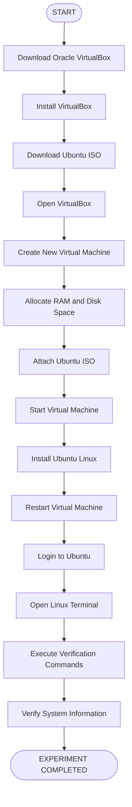
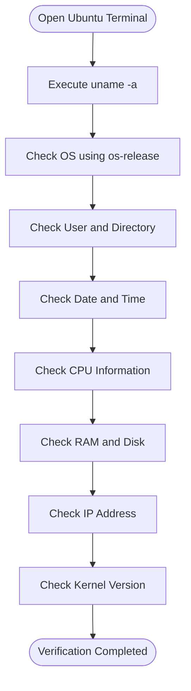

# 🚀 EXPERIMENT 01 — INSTALLATION AND CONFIGURATION OF ORACLE VIRTUALBOX AND UBUNTU LINUX

<p align="center">
  
</p>

<p align="center">
  
  
  
  
</p>

<p align="center">
  <b>OPERATING SYSTEMS LABORATORY</b><br>
  <i>Installation, Configuration and Verification of a Linux Virtual Machine</i>
</p>

---

## 📌 ABOUT THE EXPERIMENT

This experiment focuses on installing and configuring Oracle VirtualBox and setting up Ubuntu Linux in a virtualized environment.

Oracle VirtualBox is virtualization software that allows users to run multiple operating systems on a single physical computer.

In this experiment, a virtual machine is created, system resources are allocated, and Ubuntu Linux is installed using an ISO image.

After installation, different Linux terminal commands are executed to verify the operating system, kernel, CPU, memory, storage, network configuration and user information.

### ⚡ Key Concepts

- Virtualization Technology
- Virtual Machine Creation
- Oracle VirtualBox Configuration
- Ubuntu Linux Installation
- Linux Terminal Commands
- System Information and Verification

---

## 📑 TABLE OF CONTENTS

| No. | Topic |
|:---:|---|
| 01 | [Aim](#-01-aim) |
| 02 | [Objectives](#-02-objectives) |
| 03 | [Requirements](#-03-requirements) |
| 04 | [Theory](#-04-theory) |
| 05 | [Installation Procedure](#-05-installation-and-configuration-procedure) |
| 06 | [Linux Verification Commands](#-06-linux-verification-commands) |
| 07 | [Command Explanation](#-07-detailed-command-explanation) |
| 08 | [Installation Flowchart](#-08-installation-flowchart) |
| 09 | [Execution Screenshots](#-09-execution-screenshots) |
| 10 | [Expected Output](#-10-expected-output) |
| 11 | [Important Observations](#-11-important-observations) |
| 12 | [Precautions](#-12-precautions) |
| 13 | [Result](#-13-result) |

---

## 🎯 01. AIM

To install Oracle VirtualBox, create and configure a virtual machine, and install Ubuntu Linux in a virtualized environment.

---

## 🎯 02. OBJECTIVES

The main objectives of this experiment are:

1. To understand the concept of virtualization.
2. To install Oracle VirtualBox on a computer.
3. To download the Ubuntu Linux ISO image.
4. To create and configure a virtual machine.
5. To allocate RAM and virtual hard disk space.
6. To install Ubuntu Linux inside the virtual machine.
7. To understand the basic Linux terminal environment.
8. To execute Linux commands for system verification.
9. To display operating system, kernel, CPU, memory and disk information.
10. To verify the successful installation and configuration of Ubuntu Linux.

---

## 💻 03. REQUIREMENTS

### Hardware Requirements

| Component | Requirement |
|---|---|
| Computer | Desktop or Laptop |
| Processor | 64-bit processor with virtualization support |
| RAM | Sufficient memory for host and guest OS |
| Storage | Sufficient free disk space |
| Internet | Required for downloading installation files |

### Software Requirements

| Software | Purpose |
|---|---|
| Oracle VirtualBox | Virtualization software |
| Ubuntu Linux ISO | Operating system installation image |
| Windows/Linux Host OS | Physical operating system |
| Ubuntu Terminal | Executing Linux commands |

### Official Download Links

- **Oracle VirtualBox:** https://www.virtualbox.org/wiki/Downloads
- **Ubuntu Desktop:** https://ubuntu.com/download/desktop

---

## 📚 04. THEORY

### 1. What is Virtualization?

Virtualization is a technology that allows multiple operating systems to run on a single physical computer by creating virtual environments.

It allows users to run another operating system without replacing the existing operating system.

### 2. What is Oracle VirtualBox?

Oracle VirtualBox is a free and open-source virtualization software used to create and manage virtual machines.

It allows users to install and execute different operating systems such as Ubuntu, Windows and other Linux distributions on a single computer.

### 3. What is a Virtual Machine?

A Virtual Machine (VM) is a software-based computer that operates like a physical computer.

It has virtual hardware components such as:

- Virtual CPU
- Virtual RAM
- Virtual Hard Disk
- Virtual Network Adapter
- Virtual Display

### 4. What is Ubuntu Linux?

Ubuntu is a free and open-source Linux-based operating system.

It provides a user-friendly desktop environment, command-line interface and various tools for programming, system administration and software development.

### 5. What is an ISO Image?

An ISO image is a file that contains the complete installation data of an operating system.

In this experiment, the Ubuntu ISO image is attached to the virtual machine and used to install Ubuntu Linux.

### 6. What is a Linux Terminal?

A Linux terminal is a command-line interface used to interact with the operating system.

Users can execute commands to manage files, inspect system information, configure networks and perform administrative tasks.

---

## ⚙️ 05. INSTALLATION AND CONFIGURATION PROCEDURE

Follow the steps below to install Oracle VirtualBox and Ubuntu Linux.

### Step 1: Download Oracle VirtualBox

1. Open the official VirtualBox website.
2. Navigate to the Downloads section.
3. Download the appropriate VirtualBox installer for your host operating system.
4. Run the installer.
5. Follow the installation instructions.
6. Complete the installation.

Official Website: https://www.virtualbox.org/wiki/Downloads

### Step 2: Download Ubuntu Linux ISO Image

1. Open the official Ubuntu website.
2. Navigate to Ubuntu Desktop Downloads.
3. Download the Ubuntu ISO image.
4. Save the ISO file on your computer.

Official Website: https://ubuntu.com/download/desktop

### Step 3: Open Oracle VirtualBox

Launch Oracle VirtualBox after successful installation.

Click on the **New** button to create a new virtual machine.

### Step 4: Create a Virtual Machine

1. Enter the virtual machine name as `Ubuntu Linux`.
2. Select the appropriate operating system type.
3. Select Linux as the operating system.
4. Select Ubuntu (64-bit), where available.
5. Continue with the configuration.

### Step 5: Allocate RAM

Allocate sufficient RAM to the virtual machine according to the available physical memory of the computer.

The allocated memory will be used by Ubuntu Linux during execution.

### Step 6: Create a Virtual Hard Disk

1. Select the option to create a virtual hard disk.
2. Choose the appropriate disk format.
3. Select dynamically allocated storage if desired.
4. Allocate sufficient disk space.
5. Complete the virtual disk configuration.

### Step 7: Attach Ubuntu ISO Image

1. Open the virtual machine settings.
2. Navigate to Storage.
3. Select the optical drive.
4. Choose the downloaded Ubuntu ISO image.
5. Save the settings.

### Step 8: Start the Virtual Machine

Select the Ubuntu virtual machine and click Start.

The Ubuntu installation screen will appear.

### Step 9: Install Ubuntu Linux

1. Select the installation language.
2. Choose the Ubuntu installation option.
3. Configure the keyboard layout.
4. Follow the installation instructions.
5. Configure the user account and password.
6. Complete the installation process.

### Step 10: Restart the Virtual Machine

After installation:

1. Restart the virtual machine.
2. Follow any on-screen instruction to remove the installation medium if requested.
3. Log in using the configured username and password.
4. Open the Ubuntu desktop.

**Ubuntu Linux is now installed and ready for verification.**

---

## 🖥️ 06. LINUX VERIFICATION COMMANDS

After installing Ubuntu Linux, open the terminal using:

```bash
Ctrl + Alt + T
```

Execute the following commands to verify the system configuration.

### Command 1: Display Linux System Information

```bash
uname -a
```

**Purpose:** Displays complete Linux kernel and system information, including kernel name, hostname, kernel release, version, architecture and other available details.

### Command 2: Display Ubuntu Version and Details

```bash
cat /etc/os-release
```

**Purpose:** Displays information about the installed operating system, including its name, version and identification details.

### Command 3: Display Current Date and Time

```bash
date
```

**Purpose:** Displays the current system date, time and timezone information.

### Command 4: Display Current Logged-in User

```bash
whoami
```

**Purpose:** Displays the username of the currently logged-in user.

### Command 5: Display Current Working Directory

```bash
pwd
```

**Purpose:** Displays the absolute path of the current working directory.

### Command 6: Display CPU Information

```bash
lscpu
```

**Purpose:** Displays processor information such as CPU architecture, number of CPUs, cores, threads and other processor details.

### Command 7: Display Memory Usage

```bash
free -h
```

**Purpose:** Displays RAM and swap memory information in a human-readable format.

### Command 8: Display Disk Space

```bash
df -h
```

**Purpose:** Displays filesystem disk space usage, including total space, used space, available space and mount points.

### Command 9: Display IP Address Information

```bash
ip addr
```

**Purpose:** Displays network interface information and assigned IP addresses.

### Command 10: Display Ubuntu Kernel Version

```bash
uname -r
```

**Purpose:** Displays the currently running Linux kernel release version.

---

## 🔍 07. DETAILED COMMAND EXPLANATION

| Command | Function | Information Displayed |
|---|---|---|
| `uname -a` | System information | Complete kernel and system details |
| `cat /etc/os-release` | OS details | Ubuntu version and identification |
| `date` | Date and time | Current date and time |
| `whoami` | User information | Logged-in username |
| `pwd` | Directory information | Current working directory |
| `lscpu` | CPU information | Processor architecture and cores |
| `free -h` | Memory information | RAM and swap usage |
| `df -h` | Disk information | Filesystem storage usage |
| `ip addr` | Network information | Network interfaces and IP addresses |
| `uname -r` | Kernel information | Kernel release version |

### Important Linux Command Concepts

**1. uname**

Displays information about the currently running operating system kernel.

**2. cat**

Reads and displays the contents of a file.

**3. whoami**

Displays the identity of the current user.

**4. pwd**

Shows the present working directory.

**5. free**

Displays memory usage statistics.

**6. df**

Displays disk filesystem space information.

**7. ip**

Provides tools for displaying and managing network interfaces, routes and addresses.

---

## 🔄 08. INSTALLATION FLOWCHART

The following flowchart represents the complete installation and verification process.



### Verification Workflow



---

## 📸 09. EXECUTION SCREENSHOTS

The following screenshots should be captured during the actual experiment.

### Screenshot 1: Oracle VirtualBox Installation

Show the successful installation or main interface of Oracle VirtualBox.


### Screenshot 2: Virtual Machine Configuration

Show the Ubuntu Linux virtual machine created in Oracle VirtualBox.


### Screenshot 3: Ubuntu Linux Installation

Show the Ubuntu installation process or Ubuntu desktop after installation.


### Screenshot 4: Ubuntu Desktop

Show the successfully installed Ubuntu Linux desktop running inside Oracle VirtualBox.


### Screenshot 5: Linux System Information

Show the output of the following commands:

```bash
uname -a
cat /etc/os-release
```


### Screenshot 6: CPU and Memory Information

Show the output of:

```bash
lscpu
free -h
```


### Screenshot 7: Disk and Network Information

Show the output of:

```bash
df -h
ip addr
```


### Screenshot 8: Complete Command Verification

Show the terminal with the remaining commands successfully executed.


> **Important:** The screenshot paths above are placeholders. Replace them with your actual screenshots from Oracle VirtualBox and Ubuntu Linux.

---

## 📊 10. EXPECTED OUTPUT

The following outputs demonstrate the expected results of the Linux verification commands.

### 1. uname -a

Displays Linux kernel and system information.

Example:

```text
Linux ubuntu 6.x.x-generic #... SMP x86_64 GNU/Linux
```

The actual output depends on the installed Ubuntu version and kernel.

### 2. cat /etc/os-release

Displays operating system details.

Example:

```text
NAME="Ubuntu"
VERSION="..."
ID=ubuntu
ID_LIKE=debian
PRETTY_NAME="Ubuntu ..."
```

### 3. date

Displays the current system date and time.

### 4. whoami

Displays the currently logged-in username.

Example:

```text
madhav
```

### 5. pwd

Displays the current working directory.

Example:

```text
/home/madhav
```

### 6. lscpu

Displays CPU architecture and processor details.

### 7. free -h

Displays memory usage in a human-readable format.

Example:

```text
               total        used        free
Mem:            ...          ...         ...
Swap:           ...          ...         ...
```

### 8. df -h

Displays filesystem storage usage.

### 9. ip addr

Displays network interfaces and assigned IP addresses.

### 10. uname -r

Displays the currently running kernel version.

**Note:** The actual output may vary depending on the Ubuntu version, hardware configuration, virtual machine settings and system resources.

---

## 📌 11. IMPORTANT OBSERVATIONS

1. Oracle VirtualBox was successfully installed on the host computer.
2. A new virtual machine was created and configured.
3. RAM and virtual hard disk resources were allocated.
4. The Ubuntu ISO image was successfully attached.
5. Ubuntu Linux was successfully installed in the virtual machine.
6. The Ubuntu desktop environment was opened successfully.
7. Linux terminal commands were executed to inspect system information.
8. The operating system and kernel information were displayed.
9. CPU, memory and disk information were verified.
10. Network interface information was displayed using `ip addr`.

---

## ⚠️ 12. PRECAUTIONS

- Download Oracle VirtualBox only from its official website.
- Download the Ubuntu ISO image from the official Ubuntu website.
- Check that the host computer meets the virtualization requirements.
- Allocate sufficient RAM and disk space to the virtual machine.
- Ensure that hardware virtualization support is available and enabled when required.
- Attach the correct Ubuntu ISO image before starting installation.
- Follow the installation instructions carefully.
- Use the correct Linux command syntax.
- Ensure the virtual machine is properly shut down when not in use.
- Do not allocate more resources to the virtual machine than the host computer can safely provide.

---

## 🏆 13. RESULT

Oracle VirtualBox was successfully installed and configured on the host computer.

A virtual machine was created, the required hardware resources were allocated, and Ubuntu Linux was successfully installed in the virtualized environment.

The Linux terminal commands were executed successfully to verify operating system information, kernel version, current user, working directory, CPU details, memory usage, disk space and network configuration.

**Hence, Oracle VirtualBox and Ubuntu Linux were successfully installed, configured and verified in a virtualized environment.**

---

<p align="center">
  
  <b>OPERATING SYSTEMS LABORATORY</b><br>
  <i>Explore • Install • Configure • Verify</i>
</p>
