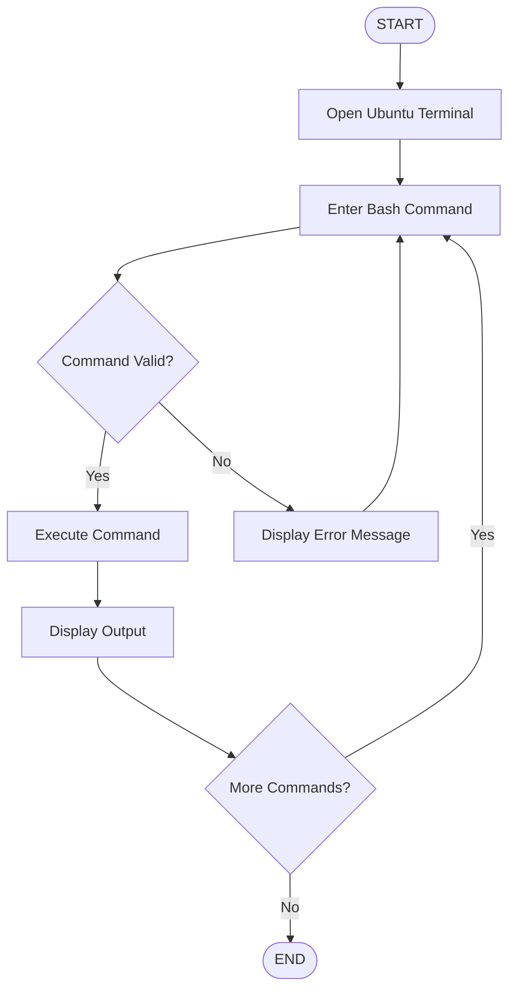
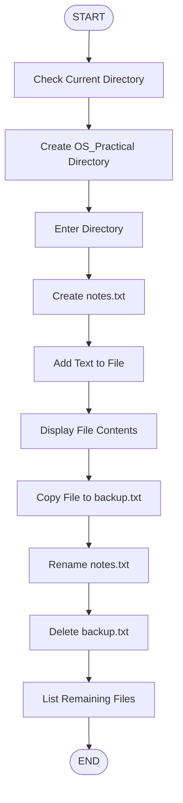
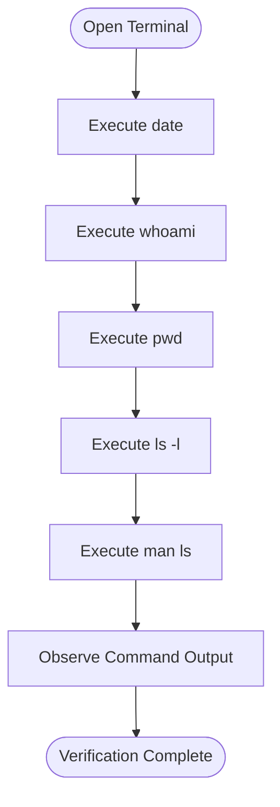

# 🚀 EXPERIMENT 02 — EXECUTION OF BASIC BASH/SHELL COMMANDS IN UBUNTU LINUX

<p align="center">
  
</p>

<p align="center">
  
  
  
  
</p>

<p align="center">
  <b>OPERATING SYSTEMS LABORATORY</b><br>
  <i>Learning Basic Linux Commands Through Bash Shell</i>
</p>

---

## 📌 ABOUT THE EXPERIMENT

This experiment focuses on studying and executing basic Bash/Shell commands in Ubuntu Linux.

The Bash shell provides a command-line interface that allows users to interact with the operating system, navigate directories, manage files, manipulate text and perform basic system operations.

In this experiment, different Linux commands are executed to understand file-system navigation, directory creation, file creation, copying, renaming, deletion, permissions and system information.

### ⚡ Key Concepts

- Bash Shell and Linux Terminal
- File-System Navigation
- Directory Management
- File Creation and Deletion
- File Copying and Renaming
- File Permissions
- System Information Commands
- Linux Manual Pages

---

## 📑 TABLE OF CONTENTS

| No. | Topic |
|:---:|---|
| 01 | [Aim](#-01-aim) |
| 02 | [Objectives](#-02-objectives) |
| 03 | [Software Requirements](#-03-software-requirements) |
| 04 | [Theory](#-04-theory) |
| 05 | [Basic Bash Commands](#-05-basic-bash-commands) |
| 06 | [Detailed Command Explanation](#-06-detailed-command-explanation) |
| 07 | [Practical File Management](#-07-practical-file-management-workflow) |
| 08 | [Procedure](#-08-procedure) |
| 09 | [Execution Flowcharts](#-09-execution-flowcharts) |
| 10 | [Execution Screenshots](#-10-execution-screenshots) |
| 11 | [Expected Output](#-11-expected-output) |
| 12 | [Important Observations](#-12-important-observations) |
| 13 | [Precautions](#-13-precautions) |
| 14 | [Result](#-14-result) |

---

## 🎯 01. AIM

To study and execute basic Bash/Shell commands for file-system navigation, file and directory management, text manipulation and system operations in Ubuntu Linux.

---

## 🎯 02. OBJECTIVES

The main objectives of this experiment are:

1. To understand the basic concepts of Bash/Shell commands.
2. To learn how to navigate through the Linux file system.
3. To display files and directories using `ls`.
4. To create directories using `mkdir`.
5. To create empty files using `touch`.
6. To display file contents using `cat`.
7. To copy files using `cp`.
8. To rename and move files using `mv`.
9. To delete files using `rm`.
10. To understand file permissions and ownership.
11. To display system information using Linux commands.
12. To access command documentation using manual pages.

---

## 💻 03. SOFTWARE REQUIREMENTS

| Component | Requirement |
|---|---|
| Operating System | Ubuntu Linux |
| Shell | Bash Shell |
| Interface | Linux Terminal |
| Virtualization Software | Oracle VirtualBox (if using a VM) |
| Commands | Basic Linux Commands |

---

## 📚 04. THEORY

### 1. What is a Shell?

A shell is a command-line interpreter that allows users to interact with the operating system.

It accepts commands from the user, interprets them and executes the requested operations.

### 2. What is Bash?

Bash stands for **Bourne Again Shell**.

It is a widely used command-line shell in Linux systems that allows users to execute commands, manage files, navigate directories and automate tasks through shell scripts.

### 3. What is a Terminal?

A terminal is an interface through which users interact with the shell by entering commands and viewing their output.

In Ubuntu, the terminal provides access to Linux commands and system utilities.

### 4. What is a File System?

A file system is a method used by an operating system to organize and store files and directories.

Linux uses a hierarchical file-system structure that starts from the root directory `/`.

### 5. What is a Directory?

A directory is a location used to store and organize files and other directories.

For example:

```text
/home/user/Documents
```

### 6. What is a File?

A file is a collection of data stored in the computer system.

Examples include:

- `notes.txt`
- `program.c`
- `readme.md`
- `data.csv`

### 7. What are File Permissions?

File permissions determine which users can read, write or execute a file or directory.

Linux provides three basic permission types:

| Permission | Symbol | Meaning |
|---|---|---|
| Read | `r` | Allows reading file contents. |
| Write | `w` | Allows modifying file contents. |
| Execute | `x` | Allows executing a file or accessing a directory. |

---

## ⚙️ 05. BASIC BASH COMMANDS

This experiment covers 14 basic Bash/Shell commands.

| No. | Command | Purpose |
|:---:|---|---|
| 01 | `pwd` | Displays current working directory. |
| 02 | `ls` | Lists files and directories. |
| 03 | `ls -l` | Displays detailed file information. |
| 04 | `cd Documents` | Changes the current directory. |
| 05 | `mkdir OS_Practical` | Creates a new directory. |
| 06 | `touch notes.txt` | Creates an empty file. |
| 07 | `cat notes.txt` | Displays file contents. |
| 08 | `cp notes.txt backup.txt` | Copies a file. |
| 09 | `mv notes.txt new_notes.txt` | Renames or moves a file. |
| 10 | `rm backup.txt` | Deletes a file. |
| 11 | `date` | Displays current date and time. |
| 12 | `whoami` | Displays current username. |
| 13 | `ls -l` | Displays file permissions and ownership. |
| 14 | `man ls` | Opens the manual page for `ls`. |

---

## 🔍 06. DETAILED COMMAND EXPLANATION

### 1. Print Working Directory — `pwd`

**Command:**

```bash
pwd
```

**Purpose:** Displays the absolute path of the current working directory.

**Example Output:**

```text
/home/user
```

**Explanation:** This command helps users identify their current location in the Linux file system.

### 2. List Files and Directories — `ls`

**Command:**

```bash
ls
```

**Purpose:** Lists files and directories available in the current directory.

**Example Output:**

```text
Desktop  Documents  Downloads  Music  Pictures
```

**Explanation:** Displays the names of files and directories without detailed information.

### 3. List Files with Details — `ls -l`

**Command:**

```bash
ls -l
```

**Purpose:** Displays detailed information about files and directories.

**Example Output:**

```text
-rw-r--r-- 1 user user 120 Oct 30 10:00 notes.txt
drwxr-xr-x 2 user user 4096 Oct 30 10:00 Documents
```

**Explanation:** Displays file permissions, number of links, owner, group, size, modification date and filename.

### 4. Change Directory — `cd`

**Command:**

```bash
cd Documents
```

**Purpose:** Changes the current working directory to Documents.

**Explanation:** After executing this command, the terminal moves into the Documents directory if it exists in the current location.

### 5. Create a Directory — `mkdir`

**Command:**

```bash
mkdir OS_Practical
```

**Purpose:** Creates a new directory named `OS_Practical`.

**Explanation:** This command creates a directory in the current working location.

### 6. Create an Empty File — `touch`

**Command:**

```bash
touch notes.txt
```

**Purpose:** Creates an empty file named `notes.txt` if it does not exist.

**Explanation:** If the file already exists, `touch` updates its modification timestamp.

### 7. Display File Contents — `cat`

**Command:**

```bash
cat notes.txt
```

**Purpose:** Displays the contents of the file `notes.txt`.

**Explanation:** It reads the contents of a file and displays them in the terminal.

**Note:** If the file is empty, no content will be displayed.

### 8. Copy a File — `cp`

**Command:**

```bash
cp notes.txt backup.txt
```

**Purpose:** Creates a copy of `notes.txt` named `backup.txt`.

**Explanation:** The original file remains unchanged while a duplicate file is created.

### 9. Rename a File — `mv`

**Command:**

```bash
mv notes.txt new_notes.txt
```

**Purpose:** Renames `notes.txt` to `new_notes.txt`.

**Explanation:** The `mv` command can also be used to move files and directories from one location to another.

### 10. Remove a File — `rm`

**Command:**

```bash
rm backup.txt
```

**Purpose:** Deletes the file named `backup.txt`.

**Explanation:** This command removes the specified file from the file system.

**Precaution:** Use this command carefully because deletion through `rm` normally does not move the file to the graphical trash.

### 11. Display Current Date and Time — `date`

**Command:**

```bash
date
```

**Purpose:** Displays the current system date and time.

**Explanation:** Shows the date, time and timezone information configured in Ubuntu.

### 12. Display Current User — `whoami`

**Command:**

```bash
whoami
```

**Purpose:** Displays the username of the currently logged-in user.

**Example Output:**

```text
user
```

### 13. Display File Permissions — `ls -l`

**Command:**

```bash
ls -l
```

**Purpose:** Displays file permissions, ownership, file size and modification time.

**Example:**

```text
-rw-r--r-- 1 user user 120 Oct 30 10:00 notes.txt
```

**Permission Explanation:**

```text
-rw-r--r--
```

| Part | Meaning |
|---|---|
| `-` | Regular file |
| `rw-` | Owner permissions |
| `r--` | Group permissions |
| `r--` | Other users' permissions |

### 14. Display Help for a Command — `man`

**Command:**

```bash
man ls
```

**Purpose:** Opens the manual page for the `ls` command.

**Explanation:** Displays detailed documentation about the command, including its usage, options and available features.

To exit the manual page, press:

```text
q
```

---

## 🗂️ 07. PRACTICAL FILE MANAGEMENT WORKFLOW

The following commands demonstrate how files and directories are managed in Ubuntu Linux.

### Step 1: Check Current Directory

```bash
pwd
```

### Step 2: List Available Files

```bash
ls
```

### Step 3: Create a Directory

```bash
mkdir OS_Practical
```

### Step 4: Enter the Directory

```bash
cd OS_Practical
```

### Step 5: Create a File

```bash
touch notes.txt
```

### Step 6: Add Text to the File

```bash
echo "Welcome to Ubuntu Linux" > notes.txt
```

### Step 7: Display File Contents

```bash
cat notes.txt
```

**Expected Output:**

```text
Welcome to Ubuntu Linux
```

### Step 8: Copy the File

```bash
cp notes.txt backup.txt
```

### Step 9: Rename the Original File

```bash
mv notes.txt new_notes.txt
```

### Step 10: List the Files

```bash
ls -l
```

### Step 11: Delete the Backup File

```bash
rm backup.txt
```

### Step 12: Verify the Remaining File

```bash
ls
```

**Expected Output:**

```text
new_notes.txt
```

---

## ▶️ 08. PROCEDURE

Follow these steps to execute the basic Bash/Shell commands in Ubuntu Linux.

1. Start the Ubuntu virtual machine.
2. Log in using the configured username and password.
3. Open the Ubuntu Terminal using `Ctrl + Alt + T`.
4. Enter the Linux commands one by one.
5. Observe the output displayed on the terminal.
6. Navigate between directories using `cd`.
7. Create a new directory using `mkdir`.
8. Create an empty file using `touch`.
9. Display file contents using `cat`.
10. Copy the file using `cp`.
11. Rename the file using `mv`.
12. Delete the backup file using `rm`.
13. Execute system information commands such as `date` and `whoami`.
14. Display file permissions using `ls -l`.
15. Open the command manual using `man ls`.
16. Record the actual outputs and capture screenshots.

---

## 🔄 09. EXECUTION FLOWCHARTS

### Flowchart 1: Basic Bash Command Execution



### Flowchart 2: File and Directory Management



### Flowchart 3: Linux System Information



---

## 📸 10. EXECUTION SCREENSHOTS

The following screenshots should be captured during the actual execution of the experiment in Ubuntu Linux.

### Screenshot 1: Ubuntu Terminal

Show the Ubuntu desktop with the terminal opened.


### Screenshot 2: Directory Navigation

Show the execution of:

```bash
pwd
ls
ls -l
cd Documents
```


### Screenshot 3: Directory and File Creation

Show the execution of:

```bash
mkdir OS_Practical
cd OS_Practical
touch notes.txt
```


### Screenshot 4: File Content and Copying

Show the execution of:

```bash
echo "Welcome to Ubuntu Linux" > notes.txt
cat notes.txt
cp notes.txt backup.txt
```


### Screenshot 5: Rename and Delete Operations

Show the execution of:

```bash
mv notes.txt new_notes.txt
rm backup.txt
ls -l
```


### Screenshot 6: System Information Commands

Show the execution of:

```bash
date
whoami
pwd
```


### Screenshot 7: File Permissions

Show the execution of:

```bash
ls -l
```


### Screenshot 8: Manual Page

Show the manual page opened using:

```bash
man ls
```


> **Important:** Replace the image paths with your actual Ubuntu terminal screenshots. Create a folder named `screenshots` inside the experiment directory.

---

## 📊 11. EXPECTED OUTPUT

The following are examples of the expected outputs. Actual results may vary depending on the directory contents and Ubuntu configuration.

### 1. pwd

```text
/home/user
```

Displays the current working directory.

### 2. ls

```text
Desktop  Documents  Downloads  Music  Pictures
```

Displays available files and directories.

### 3. ls -l

```text
drwxr-xr-x 2 user user 4096 Oct 30 10:00 Documents
-rw-r--r-- 1 user user  120 Oct 30 10:00 notes.txt
```

Displays detailed file information.

### 4. cd Documents

Changes the current directory to Documents if it exists.

### 5. mkdir OS_Practical

Creates the `OS_Practical` directory.

### 6. touch notes.txt

Creates an empty file named `notes.txt`.

### 7. cat notes.txt

Displays the file contents.

If the file is empty, the command produces no visible text.

### 8. cp notes.txt backup.txt

Creates a copy of `notes.txt`.

### 9. mv notes.txt new_notes.txt

Renames the original file.

### 10. rm backup.txt

Deletes the backup file.

### 11. date

```text
Fri Oct 30 10:00:00 IST 2026
```

Example only; actual date and time will differ.

### 12. whoami

```text
user
```

Displays the current username.

### 13. ls -l

Displays file permissions, ownership, size and modification time.

### 14. man ls

Displays the manual documentation for the `ls` command.

Press `q` to exit.

---

## 📌 12. IMPORTANT OBSERVATIONS

1. The `pwd` command successfully displays the current working directory.
2. The `ls` command displays available files and directories.
3. The `ls -l` command provides detailed file information.
4. The `cd` command changes the current working directory.
5. The `mkdir` command successfully creates a new directory.
6. The `touch` command creates an empty file.
7. The `cat` command displays the contents of a file.
8. The `cp` command creates a duplicate file.
9. The `mv` command renames or moves files.
10. The `rm` command deletes the specified file.
11. The `date` command displays the current date and time.
12. The `whoami` command identifies the current user.
13. File permissions and ownership can be inspected using `ls -l`.
14. The `man` command provides detailed documentation about Linux commands.

---

## ⚠️ 13. PRECAUTIONS

- Enter commands using the correct syntax.
- Linux commands are case-sensitive.
- Check the current directory using `pwd` before performing file operations.
- Ensure that the specified directory exists before using `cd`.
- Use unique filenames to avoid accidentally overwriting existing files.
- Use `rm` carefully because deleted files may not be recoverable.
- Check file contents before copying or deleting files.
- Press `q` to exit the manual page.
- Capture screenshots showing actual command execution and output.
- Avoid executing unfamiliar commands without understanding their purpose.

---

## 🏆 14. RESULT

The basic Bash/Shell commands for file-system navigation, file and directory management, text manipulation and system operations were successfully studied and executed in Ubuntu Linux.

The commands `pwd`, `ls`, `cd`, `mkdir`, `touch`, `cat`, `cp`, `mv`, `rm`, `date`, `whoami` and `man` were used to understand the basic working of the Linux command-line interface.

File permissions, ownership and directory information were also examined using the `ls -l` command.

**Hence, the experiment was successfully completed.**

---

<p align="center">
  
  <b>OPERATING SYSTEMS LABORATORY</b><br>
  <i>Learn • Execute • Explore • Understand</i>
</p>
